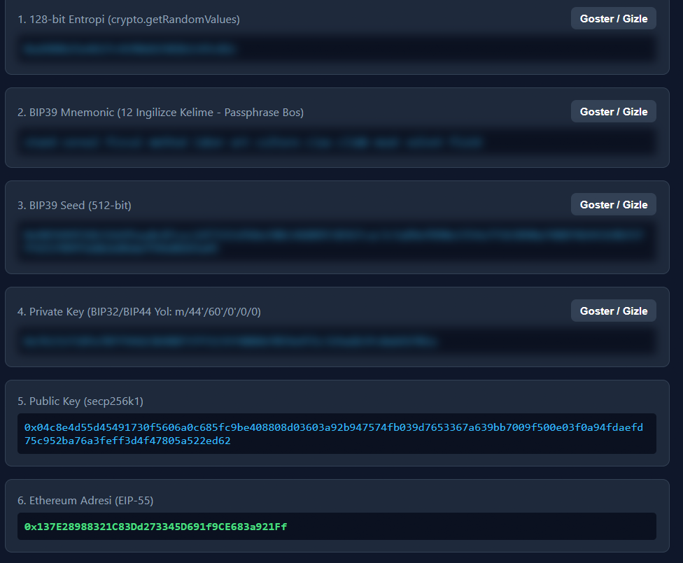
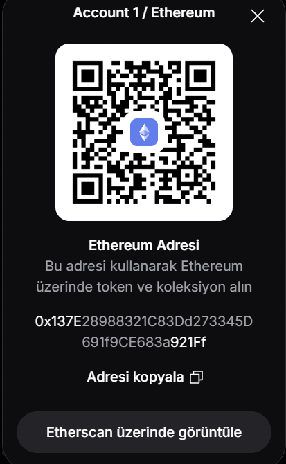
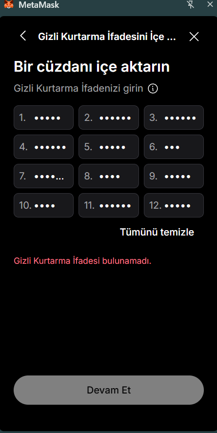

**İP 01:Blokzincir ve Ortak Kayıt**

• Blokzincir, tipik bir veritabanından farklı olarak verileri merkezi bir depo yerine verileri kriptografi yoluyla birbirine bağlanan bloklar halinde depolar. İşlem blokzincir ağındaki bir varlığın bir cüzdandan başka bie cüzdana aktarılmasıdır. Blok gerçekleşen işlemlerin bir araya getirilip paketlendiği bir veri yığınıdır, her blok kendinden önceki bloğun kriptografik hashini tutar. Dağıtık defter verilerin tek bir merkezde toplanması yerine ağdaki her bir bağımsız bilgisayar üzerinde bağımsız olarak tutulan ve güncellenen bir kayıt sistemidir.

Birbirleriyle İlişkisi:

• Ağa gönderilen işlemler doğrulanarak bir araya getirilir ve bir blok içine yazılır, her blok kendinden önceki bloğun şifrelenmiş izini taşıdığı için bu bloklar birleşerek kesintisiz olarak blokzinciri oluşturur. Bu zincirin ağdaki bütün bilgisayarlarda tutulmasına da bu yapıyı bir dağınık defter haline getirir.

• Merkezi veritabanında kayıtları ekleme, silme veya değiştirme yetkisi tek bir yöneticiye ya da kuruma aittir, bu yüzden kullanıcı o merkezin dürüstlüğüne ve güvenliğine güvenmek zorundadır. Blokzincirde ise kayıtlar ağdaki düğümler arasında dağıtık tutulur, geçmiş veriler kriptografik olarak kilitlendiği için tek taraflı değiştirilemez ve güven tek bir kuruma değil protokol kurallarına dayanır.

• Geçmiş işlemin kaydı bir kez bloğa girip kesinleştikten sonra zincir tarihçesinde silinmeden ve değiştirilmeden kalır. Sözleşmede tutulan güncel değer (state) ise yeni işlemler geldikçe kuralına uygun şekilde güncellenebilir; yani eski kayıt tarihçede dururken mevcut son durum değişmiş olur.

• Etkinlik kayıt sisteminde blokzincir kullanmanın yararı kayıtların herkesçe şeffaf biçimde doğrulanabilmesi, sonradan kimsenin müdahale edememesi ve tek bir merkeze bağımlı kalınmamasıdır. Ek maliyeti ise her kayıt/güncelleme için işlem ücreti (gas) ödenmesi, işlemin ağda onaylanma süresinin normal veritabanına göre yavaş olması ve cüzdan yönetimi gerektirmesidir.

• Benim yorumum: Verilerin çok hızlı işlenmesi gereken, sık sık güncelleme veya silme yapılan, yüksek gizlilik gerektiren ve tek bir kurumun yönetiminde olup dış taraflara merkeziyetsiz güven kanıtı sunma ihtiyacı olmayan durumlarda normal veritabanını tercih ederdim.

**İP O2:Node ve Konsensüs**

• Node bir blokzincirin protokol yazılımını çalıştıran kayıtların kopyasını tutan bir bilgisayar veya yazılımdır. Gelen işlemleri kontrol ederek diğer nodelara iletir.

• Validatör genel olarak bir şeyin kurallara ve protokollere uygun olup olmadığını denetleyen bir yazılımdır. Blokzincirde Proof of Stake ve hisse kanıtı gibi konsensüs mekanizmalarda ağ üzerindeki işlemleri doğrulayan ve yeni bloklar üreten nodelara denir.

• Konsensüs nodeların hangi protokollerin geçerli olduğu ve blokzincirin güncel durumu üzerinden bir anlaşmaya varmasını sağlar. PoW işlem gücüne ve fiziksel enerjiye dayanır, yeni bir bloğun onaylanması için bilgisayar donanımları kullanılır. PuS'ta validatorler kendi kripto varlıklarını ağa kilitlerler ve bu miktara göre blok üretme hakkı kazanırlar.

• Public/Private ağın gizli veya açık olduğunu gösterir (Topluluk ağı veya kurumsal ağ). Permissionless / Permissioned ağa katılım için önceden bir kimlik onayı gerekip gerekmediğini belirtir. Okuma izni ağdaki ağdaki işlemlerin, blokların görüntülenebilmesi, işlem gönderme ağdaki durumu güncelleyebilecek işlemler yayınlama, doğrulayıcı olma işlemleri doğrulama, onaylama,blok onaylama ve consensus mekanizmasına katılma.

• Bloğa alınma işlemin bir ağdaki bloğa girdiğini ve zincirin bloğa eklendiğini garanti eder ama sözleşmeye uygun olup olmadığını veya zincirde kalıcı olup olmadığını garanti etmez. Başarılı çalışma işlem bloğa alındıktan sonra akıllı sözleşmeye uygun bir şekilde hata vermeden çalışmasıdır ama işlemin blokta asla geri alınamayacağını garanti etmez blok tekrar havuza düşebilir veya sonraki bloklarda farklı koşullarda çalışmak zorunda kalabilir. Kesinleşme ise işlemin yer aldığı bloğun ve durum değişikliğinin geri döndürülemez hale gelmesidir.

• Çoklu düğümlü bir yapıda bulunan blokzincirde tek bir düğümün çökmesi bence ağı durdurmaz ama o düğüm kritik bir rolü tek başına üstleniyorsa o düğümün çökmesi bütün bir ağı çökertebilir.

 **İP O3:Kriptografi ve Cüzdan**

• Hash tek yönlüdür geri döndürülemez verinin bütünlüğünü ve parmak izini üretir. Şifreleme verinin gizliliğini sağlar anahtarla geri döndürülebilir,okunmasını engeller. Dijital imza kimlik doğrulamasıdır verinin kimden geldiğini doğrular.

• Private key, public key, adres, mnemonic ve seed hiyerarşik türetme zincirinin farklı katmanlarıdır. Her katman bir öncekinden aynı girdiden her zaman aynı sonuç çıkacak şekilde üretilir. Cüzdan çnce rastgele bir bit dizisi üretir ve bunu standart bir kelime listesiyle mnemonice dönüştürür. Mnemonic kelimeleri bir anahtar türetme fonksiyonundan geçirilerek seed üretilir, seed çok sayıda hesabı türeten bir kök malzemedir. BIP-32 BIP-44  ile seed'den belirli türetme yollarına göre birden fazla private key üretilir. Her özel anahtardan belirli matematiksel fonksiyonlarla karşılık gelen public keyler üretilir. Hash fonksiyonları ve kodlama kurallarıyla public key kısaltılıp bir adres haline getirilir.

• Entropi Özel anahtarların ve mnemonic ifadelerin tahmin edilemez olması için oluşturulan rastgele bit dizileridir. Checksum entropinin hash değerlerinin başından alınan ve entropinin en sonuna eklenen değerlerdir. BIP39 entropi ve checksum bitlerini 11-bitlik bölümlere ayırıp mnemonic kelimelere çevirir. BIP32 BIP 39'dan çıkan seed'leri kök olarak alıp private ve public keyler oluşturur. BIP44 BIP32 ağacında hangi dalın hangi amaçla kullanılacağını belirtir.  

• Cüzdan uygulamasıyla hesap aynı şey değildir. Cüzdan uygulaması hesapları oluşturan, bakiyeyi tutan, işlemleri onaylayıp ağa gönderen yazılımdır. Hesap ise bakiyeyi, özel anahtarı,yetkileri tutan kriptografik kimliktir. Adres paylaşımı bir güvenlik zaafiyeti oluşturmasa da bir mahremiyet etkileri vardır. Özel anahtarların paylaşılması ise güvenlik açısından sıkıntılıdır cüzdandaki bakiyelerin kaybına sebep olabilir. 

• Cüzdan uygulanmasının silinmesi tek başına bir sorun teşkil etmez varlıklar hala aynı yerinde duruyor olur, kurtarma bilgisinin kaybında ise varlıklar zincirde gözükmeye devam etse bile onlar üstünde işlem yapma yetkisi kaybolur.

 **İP O4:Bitcoin Ethereum ve Token**

• Bitcoinin temel amacı eşler arası merkeziyetsiz bir para saklama aracı sunmak. Programlanabilirliği bilerek sınırlı ve odaklıdır örnek olarak çoklu imza, zaman kuralları kullanılarak parasal güvenliği öncelemek üzere tasarlanmıştır. Ethereumun temel amacı programlanabilir bir dağıtık durum makinesi sunmaktır. Akıllı sözleşmeler ve sanal makinesi sayesinde karmaşık uygulamaların, protokollerin zincir üzerinde doğrudan çalışmasını hedeflemiştir.

• Native varlık ağ protokolünün kendisinde tanımlı olan ve ağın işleyişini destekleyen temel varlıktır. ETH ethereumun temel varlığıdır ağdaki ücretleri ödemek için kullanılır ve protokol seviyesinde bir temel varlıktır. Token ise ağ protokolünde gömülü olmayan ağın üstünde çalışan bir varlıktır ve bir akıllı sözleşme tarafından yönetilir. USDC ethereum ve ağında akıllı sözleşme aracılığıyla işlem gören bir tokendir. Transfer edilirken ağın native varlığı olan ETH ile gas ödenir.

• Stablecoin fiyat dalgalanmalarını engellemek amacıyla belli bir mekanizmaya veya dolar gibi birimlere endekslenen varlık türüdür. NFT ise her birinin benzersiz ve birbirinin yerini tutamaz olduğu token türüdür. Dijital veya fiziksel bir varlığa ait sahiplik veyahut kimlik kaydını ifade eder. ERC-20 ise ethereum üzerinde birbirinin yerine geçebilen, bölünebilir standart birim tokenler oluşturmak için kullanılan bir arayüzdür. Cüzdanların, borsaların ve uygulamaların bakiyelerini ve transferlerini belirlenmiş ortak kurallarla tanımasını sağlar.

• Gerçek fonların ve canlı kullanıcıların bulundupu mainnet'i kod hatalarından, protokol denemelerinden ve başarısız denemelerden korumak için testnet ayrılır. Test ETH ve Test USDC gerçek varlıklarla aynı değeri taşımaz. Testnet varlıkları test amacıyla dağıtılmakta oluğ gerçek dünyada maddi bir değerleri bulunmaz.

• Etkinliğe giriş için token gerekmez erişim hakkı doğrudan bir akıllı sözleşmedeki izin listesi kriptografik imza veya o anki bir şartın sağlanmasıyla da kontrol edilebilir. Her erişim kuralının alınıp satılan bir token olması zorunlu değildir. Bunlara ek olarak zincir dışı olarak merkezi veri tabanı kaydı, dacet listesi veya kimlik ve e posta doğrulaması gibi işlemler de token olmadan iş görür.

 **İP O5:Akıllı Sözleşme ve ABI**

• Akıllı sözleşme blokzincirinin üzerinde çalışan kuralları önceden belirlenmiş ve bu kurallara göre işlem mantığını yürüten ve kendi statetini yönetebilen programdır. EVM(Ethereum Virtual Machine) tüm nodeların işlemlerini aynı sonuçla çalıştırabilmesini sağlayan izole bir sanal makinedir. Kaynak kodu bytecode komutlarını gas sınırları içinde yürütür. State ağdaki hesapların ve sözleşmelerin güncel verilerinin anlık toplamıdır. Her geçerli işlem eskisinden yeni state bir geçiş üretir.

• Geliştirici tarafından geliştirilen insanların okuyabileceği kod derleyici tarafından ile EVM'nin anlayabileceği ikili bir bytecode'a çevrilir. Derlenen bytecodeunu özel bir dağıtım işlemiyle ağa gönderilmesine deploy denir.

• ABI bir çeviri uygulamasıdır. Dış uygulamaların bytetaki olaylarla ve fonksiyonlarla nasıl iletişim kuracağını belirler. Kaynak kod derlendiği anda derleyici çıktısı olarak elde edilir. Ağ/Chain bilgileri ve istemci/bağlam bilgileri gerekir.

• Veri okumada ağ durumu değişmez ama statede güncellenir. Veri okumada ağ mutabakatı veya blok üretirimi gerekmez çoğunluk olarak yerel düğümden okunur. State'te ise işlem havuzuna girer ve bloğa alındıktan sonra ağda yürütülüp kesinleşir. Gas konusunda ise veri okumada normal bir kullanıcı ücret ödemezken state de yapılan işlemin ağda yayılması ve işlenmesi için gas ödenir. Veri okuma imza gerektirmezken state de gönderen hesabın özel anahtarıyla imzalanır.

• Kaynak kodu verify etmek bytecode'un sizin sundupunuz kaynak kodun ve belirtilen derleyici ayarlarının derlenmesiyle aynı çıktıyı çıkardığı doğrulanır. Güvenlik denetimiyle aynı şey değildir sadece bytecode'un eşlendiğini doğrular güvenlik zaafiyeti vb. içerip içermediğini belirtmez.

• Kod şablonu aynı olsa bile her dağıtım kendine has izole bir state alanına sahip bağımsız bir sözleşme oluşturduğundan kayıtları ayrı olabilir.

 **İP O6:RPC Explorer ve Event**

 • RPC(Remote Procedure Call) dış bir uygulama veya web arayüzü,cüzdan betik gibi istemcilerin, ağdaki bir düğümee sanki lokal bir fonksiyon çağırıyor gibi istek göndermesini sağlayan iletişim protokolüne denir. RPC endpoint bu isteklerin gönderildiği somut adrestir http:// gibi. Node blokzincirin verisini tutan ve protokol kurallarını çalıştıran birimdir kendi düğümünü kurmak isteyen kullanıcılar ise RPC hizmet sağlayıcısını kullanır.

 • Block explorer zincirdeki blokları, işlemleri, adres bakiyelerini, akıllı sözleşme kodlarını ve log/event kayıtlarını daha kullanışlı bir arayüzle arayıp görüntülemeyi sağlayan web uygulamasıdır. Explorerin kapanması ağın durdurmasını göstermez explorer bir arama aracı gibidir kapansa bile düğümler çalışmaya devam eder. Bir RPC endpointin kapanması ise yalbızca o adresle bağlı olan isteklerin başarısız olmasına yol açar.

 • Güncel state sözleşmenin deposunda tutulan o anki güncel değerlerdir. Akıllı sözleşme fonksiyonları depolamayı doğrudan okuyabilir. Event log ise geçmişe dönük olay kayıtlarıdır akıllı sözleşmeler doğrudan ulaşamaz. Indexer ise blokları ve logları dinleyip çözer ardından filtreler ve hızlı sorgulanabilir bir arayüze ekler çünkü ham blokları tek tek taramak çok zordur.

 • Explorer yoksa doğrudan düğüm RPC sorgulama hattını araştırırım. Güvenilir bir RPC üzerinden doğrudan düğüm sorguları yapıp veriyi ABI ile çözümleyerek kayıt doğrulanır.

  **İP O7:Bir İşlemin Yolculuğu** 

  • Cüzdan bağlamak web veya uygulama arayüzü üzerinden cüzdan eklentisi veya bir sağlayıcı kullanarak kullanıcının aktif hesapını,adresini ve ağ bilgisini okutmasıdır. Mesaj imzalama kullanıcının özel anahtarıyla belirli bir metni veya herhangi bir yapılandırılmış veriyi imzalamasıdır. Genellikle state'i değiştirmez gas ücreti kullanılmaz. İşlem göndermek ise state'i değiştirecek imzalı olan bir veri paketinin ağa yayınlanmasıdır. Mempoola girer, bloğa alınır ve ağdaki düğümler tarafından işlenir, gas ücreti alınır.

  • Gas limiti işlemin yürütülmesi sırasında harcanmasına izin verilen hesaplama/depolama birimi olan gas'ın maksimumunu belirtir. Gas used işlem sırasında harcanan gasdır. İşlem ücreti yapılan işlemin işlenmesi karşılığında ödenen toplam ücret. Nonce hesaptaki işlemlerin sırasını belirtir, işlemlerin sıralı bir biçimde işlenmesini sağlar. Chain ID işlemin hangi blokzincir ağı için imzalandığını belirten bir ağ kimliği. Başka bir ağda tekrar yayınlanmasını engeller.

   • Txid/Transaction Hash işlem verisinin kriptografik hashidir ve o işlemi benzersiz olarak tanımlar. Sözleşme adresi bir akıllı sözleşmenin ağda deploy edildiği konumdur. Sözleşmenin kodu ve kendi state alanı burada bulunur. Block hash bir bloğun başlık verilerinin hash'lenmesinden elde edilen benzersiz bir blok kimliğidir. Her blok kendinden önceki bloğun hashini tutarak zincir yapısını oluşturur.

  • Pending işlemin havuza ulaştığı ve mempoolda beklediği daha bir bloğa eklenmediği aşamadır. Receipt işlemin bir bloğa alındıktan sonra yürütülen kayıt özetine denir. Hangi blokta işlendiğini, gas used değerini logları ve statusu içerir. Status işlemin EVM içinde başarılı mı yoksa başarısız mı olduğunu belirtir, genellikle 1 başarılı 0 başarısız kabul edilir. Hash yalnızca işlemin kimliğini gösterir işlemin pending olabileceğini başarısız olabileceğini veya diğer durumları ortaya koymaz. Kesin bir sonuç için receipt ile statuse baklılır.

• İşlem Akış Şeması:
İmzalama (İşlem verisi hazırlanıp private key ile imzalanır) → Gönderme (İmzalı işlem RPC üzerinden ağa iletilir ve txHash oluşur) → Bekleme / Pending (İşlem mempool havuzunda bloğa girmeyi bekler) → Bloğa Alınma (Doğrulayıcılar işlemi bloğa alıp EVM üzerinde çalıştırır ve receipt/status üretir) → Sonuç Kontrolü (Receipt üzerinden status değerinin 1 mi 0 mı olduğu kontrol edilir).

• Sonucunu öğrenemedim henüz netleşmemiş veya ağ/RPC kaynaklı ulaşılamamış bir durumu gösterirken, işlem başarısız (status = 0) işlemin çalışıp hata nedeniyle geri alındığı kesin olumsuz sonucu ifade eder.

  **İP O8:Ekosistemi Tanı** 

• Web3 merkezi platformlar ve aracılar yerine kullanıcıların cüzdan ve akıllı sözleşmelerle veri ve varlık yönetimini doğrudan yapabildiği internet yapısıdır. L1 güvenliği ve mutabakatı kendi üzerinde sağlayan ana blokzincir (Ethereum gibi), L2 ise ana zincirdeki yoğunluğu ve ücretleri azaltmak için işlemleri üst katmanda toplayıp güvenliği L1'e dayandıran ölçekleme katmanıdır. DeFi aracılar olmadan akıllı sözleşmelerle takas, borç verme gibi finansal işlemlerin yapıldığı sistemdir. DAO kuralları ve yönetim kararları akıllı sözleşmeler ve oylamalarla yürütülen topluluk yapısıdır. Oracle akıllı sözleşmelerin zincir dışındaki fiyat, hava durumu gibi gerçek dünya verilerine ulaşmasını sağlayan veri köprüsüdür. Bridge farklı blokzincir ağları arasında varlık veya veri aktarımını sağlayan köprü sistemidir. Zero-Knowledge Proof (ZK) ise bir bilginin veya hesaplamanın doğruluğunu, gizli olan asıl veriyi karşı tarafa açmadan matematiksel olarak kanıtlayan 
yöntemdir.   

• Kullanım Örnekleri: Dijital kimlik için kişinin açık kimlik bilgilerini vermeden sadece 18 yaşından büyük olduğunu kanıtladığı cüzdan tabanlı doğrulama sistemi örnek verilebilir. RWA için gayrimenkul hissesinin veya hazine bonosunun zincir üzerinde token haline getirilmesi örnek gösterilebilir. DePIN için ise bireylerin kendi internet erişim noktalarını veya depolama cihazlarını ağa bağlayıp hizmet karşılığı ödül kazandığı altyapı ağları örnek verilebilir.   

• ZK ile bir koşulun veya hesaplamanın kurallara uygun doğru olduğu kanıtlanır, doğum tarihi veya bakiye gibi gizli girdiler ise karşı tarafa gösterilmeden saklanır. Örneğin sisteme tam doğum tarihini vermeden sadece 18 yaşından büyük olunduğu kanıtlanabilir. "ZK kullanılıyor" ifadesi bütün işlemlerin gizli olduğu anlamına gelmez; ZK-rollup gibi sistemlerde ZK kanıtı sadece işlem doğruluğu ve ölçekleme için kullanılırken adres ve işlem bilgileri açık kalabilir. 

• DAO'yu en son öğrenmek istiyorum; çünkü önce blokzincir altyapısını, akıllı sözleşmelerin çalışmasını ve temel ağ/ölçekleme mekanizmalarını oturtup, yönetişim ve karar süreçlerini bu teknik temelin üzerine inşa etmek daha mantıklı geliyor.

**IP09:Gerçek Bir Blokzincir Projesini İncele**

• Seçilen Proje: Safe (eski adıyla Gnosis Safe). Resmî sitesi: safe.global | Resmî dokümantasyonu: docs.safe.global.   

• Tek bir özel anahtarın kaybolması, çalınması veya tek kişinin hatalı/kötü niyetli işlem yapması riskine karşı hesap kontrolünü birden fazla imzalayıcıya (M-of-N eşik mantığı) ve kurallara paylaştırır; ekipler, hazine yöneten projeler ve kurumlar için uygundur. Zincirde yapılan işlemler Safe akıllı sözleşme hesabının oluşturulması, sahip/eşik kurallarının tutulması ve yeterli imza toplandığında asıl işlemin yürütülmesidir. Zincir dışında yapılan hizmetler ise web arayüzü, imzalayıcıların işlemleri görüp onayladığı koordinasyon servisi (Transaction Service) ve geçmiş verileri hızlı sorgulayan indeksleme altyapılarıdır.  

• Varlıkların ve yetkilendirme kurallarının tek bir sunucu yerine herkesçe doğrulanabilen akıllı sözleşmelerde ve kriptografik imzalarda tutulmasını sağlamak için blokzincir kullanır. Normal bir veritabanıyla yapılsaydı veritabanı yöneticisi onay kayıtlarını veya bakiyeleri tek taraflı değiştirebilir, işlemleri sansürleyebilir ve sistem kapandığında kullanıcılar varlıklarına kendi anahtarlarıyla erişemezdi.   

• Safe'te asıl güvenlik akıllı sözleşmedeki kurallarda durur. Yönetici/diğer imzalayıcılara işlem onay aşamasında anahtarlarını koruyacakları ve kötü niyetli onay vermeyecekleri konusunda güvenilir (ancak tek başlarına fon kaçıramazlar). İşletmeciye (arayüz ve Transaction Service) işlemlerin toplanması ve ekranda doğru gösterilmesi aşamasında güvenilir (çökse bile fonlar sözleşmede güvendedir). Veri sağlayıcısına (RPC ve indexer) ise cüzdan bakiyesi ve onay durumunu okurken doğru bilgi sunduğu konusunda güvenilir. 

• Benim yorumum: Safe'in en güçlü tarafı tek anahtar bağımlılığını ortadan kaldırıp ekip ve hazine yönetiminde yüksek güvenlik sunmasıdır. Sınırlaması ise her işlem için birden fazla kişinin onay vermesi gerektiğinden işlem hızının tek anahtarlı cüzdana göre yavaş olması ve onay/yürütme adımlarında gas maliyeti oluşmasıdır. 

**İP 10: Blokzincir Yarışması Şartnamesini İncele**

• İncelenen Resmî Şartname: TEKNOFEST 2026 Havacılık, Uzay ve Teknoloji Festivali Blokzincir Yarışması Teknik Şartnamesi (Versiyon 1.1). Takımlar danışman hariç 2-5 kişiden oluşur, en fazla 1 danışman eklenebilir ve süreçler KYS sistemi üzerinden yürütülür. 

• Yarışma merkeziyetsizlik, şeffaflık ve değiştirilemezlik ilkeleriyle kamu yönetimi, eğitim, finans, sağlık ve tedarik zinciri gibi güven gerektiren alanlardaki gerçek dünya problemlerine çözüm üretmeyi amaçlar. Yarışmanın kabul ettiği 7 ana kapsam: Yüksek Başarımlı ve Ölçeklenebilir DLT Altyapıları, DLT Sistemlerinde Mahremiyet, Dijital Cüzdanlar, Blokzincir Kriptolojisi, Blokzincir Güvenliği, Kripto Varlık Regülasyon Altyapıları ve Seçilmiş DLT Uygulama Alanları (Dijital Kimlik, Orijin Takibi, DeFi, Tokenizasyon, Web3/DAO).   

• Beklenen Çıktılar ve Değerlendirme: Süreç 4 aşamalıdır ve puanlama ağırlıkları şöyledir: Proje Ön Değerlendirme Raporu (%10), Proje Sunum Raporu (%15 - varsa kaynak kodlar da incelenir), Özet Proje Sunum Puanlaması / Çevrim İçi Sunum (%15) ve Final Sunum Puanlaması (%60). Projeler katma değer/yenilikçilik, teknoloji kullanımı, uygulanabilirlik, yaygın etki ve sürdürülebilirlik kriterlerine göre puanlanır.   

• Kavram Açıklamaları: DLT (Dağıtık Defter Teknolojisi), verilerin merkezi bir sunucu yerine ağdaki katılımcılar arasında senkronize ve değiştirilemez biçimde tutulduğu sistemlerin genel adıdır. MPC (Çok Taraflı Hesaplama), özel anahtarı parçalara bölerek anahtarı birleştirmeden ortak imza atmayı sağlayan yöntemdir. Proof of Reserve (PoR), bir kurumun beyan ettiği varlıkların gerçekten rezervde bulunduğunu kriptografik olarak kanıtlamasıdır. Travel Rule, belirli tutar üstü transferlerde gönderici-alıcı bilgisinin paylaşılmasını gerektiren regülasyon kuralıdır. Homomorfik Şifreleme, verinin şifresini çözmeden şifreli hali üzerinde işlem yapabilmeyi sağlayan şifreleme yöntemidir. Sharding/Sidechain/Rollup ise ana zincirin işlem kapasitesini artırmak için ağı parçalama, yan zincir kurma veya işlemleri dışarıda toplayıp ana zincire özetleme ölçekleme yaklaşımlarıdır. 

• Benim yorumum: Bu programda öğrendiğim akıllı sözleşme mimarisi, zincir içi (on-chain) ile zincir dışı (off-chain) veri ayrımı, cüzdan güvenliği ve RPC/event tabanlı uygulama geliştirme konularının yarışmada en çok işe yarayacağını düşünüyorum. Şartnamede teknolojinin etkin kullanımı, uygulanabilirlik ve kaynak kod incelemesi öne çıktığı için hangi verinin zincirde tutulup hangisinin dışarıda işleneceğini doğru kurgulamak prototip geliştirirken belirleyici olacaktır.   

**IP11:Çalışma Ortamını Hazırla**

• Git: Dosyalarda yapılan değişiklikleri adım adım takip etmeyi, geçmiş sürümlere dönmeyi ve ekip halinde çakışma olmadan kod geliştirmeyi sağlayan dağıtık bir versiyon kontrol sistemidir.

• GitHub: Git ile yönetilen projelerin ve depoların internet üzerinde barındırılmasını, yedeklenmesini, paylaşılmasını ve takım çalışması yapılmasını sağlayan bulut tabanlı platformdur.   

• README: Bir projenin veya GitHub deposunun ana sayfasında görünen, projenin amacını, içeriğini, kurulum adımlarını ve nasıl kullanılacağını özetleyen tanıtım dosyasıdır (genellikle README.md).   

• Commit: Proje klasöründe yapılan değişikliklerin, ne yapıldığını anlatan kısa bir açıklama mesajıyla birlikte yerel Git geçmişine kalıcı bir kayıt noktası olarak işlenmesidir.   

• Push: Yerel bilgisayarda commit ile kaydedilmiş değişikliklerin, uzak sunucudaki (örneğin GitHub üzerindeki) depoya gönderilip eşitlenmesi işlemidir.

• Solidity, Ethereum ve EVM uyumlu blokzincirlerde çalışacak akıllı sözleşmeleri yazmak için kullanılan programlama dilidir. Remix IDE ise herhangi bir kurulum gerektirmeden doğrudan tarayıcı üzerinden Solidity kodu yazmayı, derlemeyi, test etmeyi ve ağa deploy etmeyi sağlayan geliştirme ortamıdır.

• Bu kurulum sürecinde Remix IDE ve MetaMask'in doğrudan tarayıcı üzerinden akıllı sözleşme ve test ağıyla iletişim kurma yapısı benim için yeniydi.

**IP12: Kendi Cüzdan Oluşturucunu Yaz**

• Kullanılan Dönüşümler ve Kütüphane Çağrıları:

• Entropi: Tarayıcının yerleşik crypto.getRandomValues(new Uint8Array(16)) fonksiyonu ile tahmin edilemez 128-bit (16 bayt) rastgele veri üretildi.

• Mnemonic (BIP39): ethers.Mnemonic.fromEntropy(entropyBytes, "") çağrısı ile entropiye checksum bitleri eklenip 12 İngilizce kelimeye dönüştürüldü (ek passphrase boş bırakıldı).

• Seed: mnemonicObj.computeSeed() ile 12 kelimeden PBKDF2 tabanlı 512-bit kök seed üretildi.

• Private Key (BIP32/BIP44): ethers.HDNodeWallet.fromSeed(seedHex).derivePath("m/44'/60'/0'/0/0") ile Ethereum'un standart ilk hesap yolundaki 32 baytlık private key türetildi.

• Public Key: new ethers.SigningKey(privateKey).publicKey ile eliptik eğri (secp256k1) çarpımı yapılarak public key elde edildi.

• Ethereum Adresi: ethers.computeAddress(publicKey) ile sıkıştırılmamış public key'in Keccak-256 özetinin son 20 baytı alınıp EIP-55 formatında adres oluşturuldu.

• Uygulamamda gördüğüm üzere mnemonic (12 kelime) bütün cüzdan ağacının kökünü oluşturan ve birden fazla hesabı geri getirebilen bir yedekleme anahtarıdır, private key ise o mnemonic'ten belirli bir türetme yoluyla (m/44'/60'/0'/0/0) çıkarılan ve yalnızca tek bir Ethereum hesabının işlemlerini imzalamaya yarayan 32 baytlık gizli anahtardır.
 
**IP13: MetaMask ile Karşılaştır ve Checksum Deneyi Yap**

• İstenilen görevler ve karşılaştırmalar yapıldı ekran görüntüleri alındı.

• Geçerli mnemonic ile güvenli biçimde üretilmiş mnemonic aynı şey değildir. Bir mnemonic'in geçerli sayılması için sadece BIP39 kelime listesindeki kelimelerden oluşması ve sonundaki 4 bitlik checksum kontrolünden geçmesi yeterlidir

